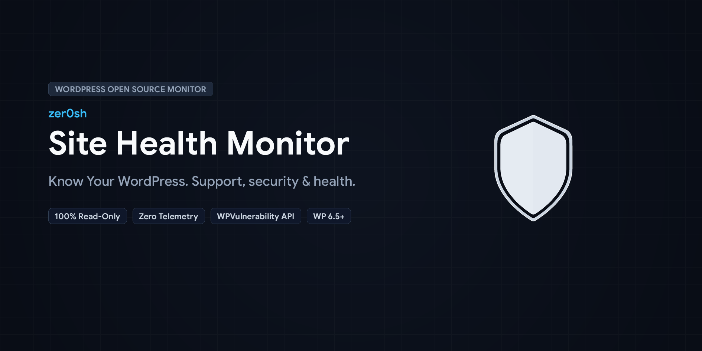
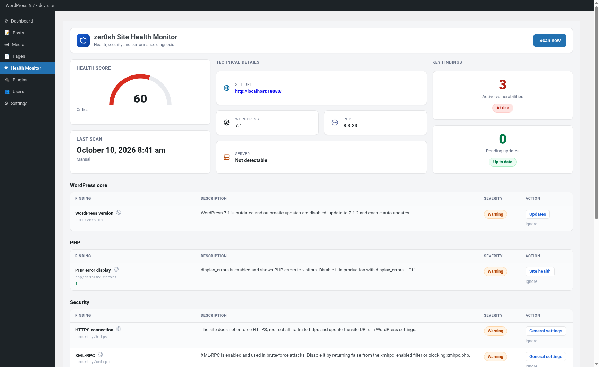
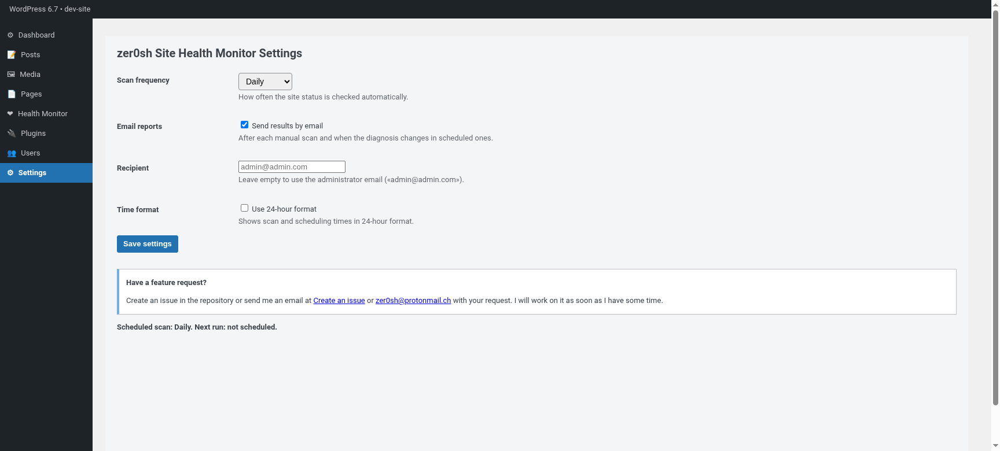

# zer0sh Site Health Monitor



> Plugin open source ultra ligero para diagnosticar de forma integral la salud, seguridad, vulnerabilidades y configuración de cualquier sitio WordPress en una única pantalla.

## ¿Qué es?

**zer0sh Site Health Monitor** es un plugin de WordPress de solo lectura diseñado para responder a una pregunta fundamental de mantenimiento: ***¿Está mi WordPress actualizado, soportado, seguro y correctamente configurado?***

El plugin prioriza la simplicidad, la privacidad absoluta del sitio y la ausencia de dependencias pesadas:
* **100% Read-only**: No modifica archivos, base de datos ni configuraciones del servidor automáticamente.
* **Cero telemetría**: No rastrea actividad, no requiere cuentas de usuario ni API keys de pago.
* **Ultra ligero**: Diagnósticos en local con caché nativa en transients (12 horas por defecto).

## ¿Qué comprueba?

* **Entorno PHP**: Versión activa y estado de soporte oficial (EOL), `memory_limit`, `display_errors`, extensiones obligatorias de WordPress.
* **WordPress Core**: Versión instalada vs versión estable disponible y estado de auto-actualizaciones.
* **Actualizaciones**: Detección de plugins y temas activos con versiones pendientes.
* **Seguridad del sitio**: Conexión HTTPS forzada, estado de XML-RPC, edición de archivos (`DISALLOW_FILE_EDIT`), modo debug (`WP_DEBUG`/`WP_DEBUG_LOG`) y cabeceras de seguridad HTTP (`HSTS`, `CSP`, `X-Frame-Options`, `X-Content-Type-Options`).
* **Salud y fiabilidad**: Programador `WP-Cron` y peticiones loopback del servidor.
* **Vulnerabilidades conocidas**: Consulta transparente a la base de datos pública de **WPVulnerability API** (sin enviar datos sensibles del sitio ni credenciales).

## Capturas

### Dashboard


### Ajustes y Reportes


## Instalación y Entorno Local

### Requisitos
* WordPress 6.5 o superior.
* PHP 7.4 o superior (compatible con PHP 8.0, 8.1, 8.2, 8.3, 8.4 y 8.5).

### Entorno de desarrollo local (Docker)

El proyecto incluye un entorno Docker Compose listo para usar:

```bash
# Levantar el entorno
make up

# Detener el entorno
make down

# Reiniciar
make restart
```

WordPress estará disponible en `http://localhost:18080`. El plugin se monta automáticamente en `wp-content/plugins/zer0sh-site-health-monitor`.

## Calidad y herramientas de desarrollo

El proyecto sigue estrictamente los estándares de código de WordPress (WPCS) y arquitectura PSR-4:

```bash
# Instalar dependencias de desarrollo (PHPCS, WPCS, PHPUnit)
make composer-install

# Verificar estándares de código (PHPCS)
make lint

# Corregir automáticamente errores de estilo (PHPCBF)
make lint:fix

# Ejecutar suite de pruebas unitarias (PHPUnit)
make test

# Generar el paquete ZIP limpio para distribución en WordPress.org
make package
```

## Licencia

Este proyecto está bajo la licencia [GPLv2 o posterior](LICENSE).
